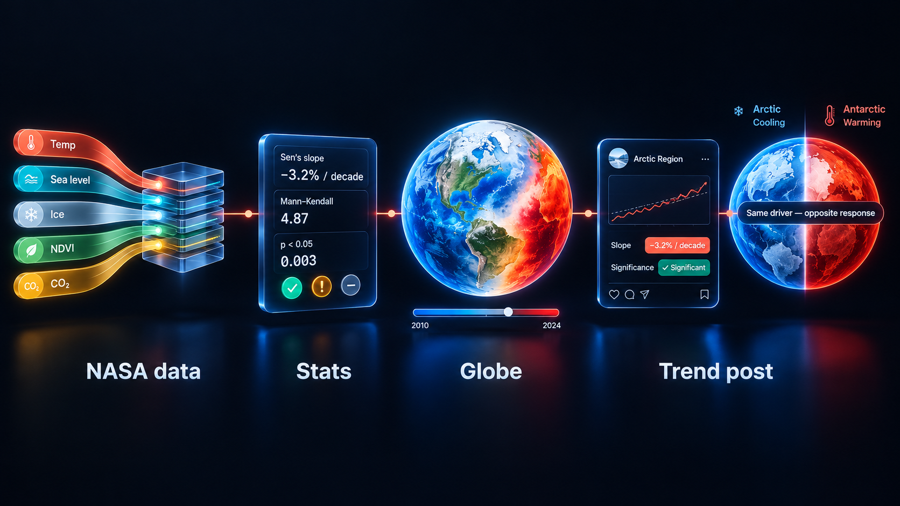

# Bluegram

**Instagram for Earth systems** — a 3D globe explorer that surfaces statistically validated regional trends from NASA data: **what** is changing, **where** it is changing, **how much** it is changing, and **whether it is statistically significant**.



## Challenge Mapping (4 Questions → 4 UI Answers)

| Space Apps Challenge Question | Bluegram Implementation |
| --- | --- |
| **1. What is changing?** | **4 NASA POWER Variables**: Surface Temperature (`T2M`), Precipitation (`PRECTOTCORR`), Solar Radiation (`ALLSKY_SFC_SW_DWN`), and Relative Humidity (`RH2M`), plus live **NASA EONET v3** natural events and **ISRO / ESA / JAXA / Pixxel** supplemental layers. |
| **2. Where is it changing?** | **Interactive 3D Globe (`Three.js` + NASA GIBS WMS)**: 13 canonical regions (10 global + 3 Indian subcontinent anchors: Western Ghats, Indo-Gangetic Plain, Sundarbans) with live **GIBS Layer Switcher** (`Blue Marble`, `MODIS Terra True Color`, `VIIRS Night Lights`). |
| **3. How much is it changing?** | **Theil–Sen Estimator (`scipy.stats.theilslopes`)**: Non-parametric decadal slope (`unit / decade`) rendered on every marker, feed card, and Recharts annual time series overlay. |
| **4. Is it significant?** | **Mann–Kendall (`pymannkendall`) + Benjamini–Hochberg FDR (`q-value`)**: Every post displays a significance stamp (`Significant p < 0.05`, `Borderline 0.05–0.10`, `Not significant > 0.10`, or `Insufficient data` if `>20%` missing) alongside spatial FDR `q-values`. |
| **Twist: Same driver, opposite direction** | **Contradiction Detector (`SplitGlobe` + `DuelingPosts`)**: Dual 3D globes and stacked telemetry cards contrasting curated pairs (e.g. Arctic vs Antarctic, Western Ghats vs Indo-Gangetic Plain) and live opposing trends from `/api/trends`. |

---

## Features

- **3D Globe & GIBS Switcher** — Switch between NASA GIBS `Blue Marble Bathymetry`, `MODIS Terra True Color`, and `VIIRS Black Marble` in real time; slope-colored 3D pins with Fresnel atmospheric halo.
- **Multi-Variable Feed** — Temperature (`Coral`), Precipitation (`Blue-Violet`), Solar Radiation (`Amber`), and Relative Humidity (`Teal`) across 13 regions, sorted by Mann–Kendall p-value.
- **Statistical Rigor** — Deseasonalized monthly series (1981–2025, 540 months), Mann–Kendall `p-value`, Benjamini–Hochberg spatial FDR `q-value`, Theil–Sen decadal slope, and `>20%` missing-data guard.
- **Contradiction Detector** — Canvas-first dual-globe comparison with custom glass pair combobox (`Featured` + `Live Detected` pairs), `|Δ slope|` readout, and AI synthesis.
- **NASA EONET v3 + Partner Layers** — Live natural events within 1,800 km of each region (`eonet.gsfc.nasa.gov/api/v3/events`) plus ISRO Bhuvan/MOSDAC, ESA Copernicus, JAXA GSMaP, and Pixxel Firefly Mode A supplemental telemetry cards.
- **Verifiable Science (IPFS)** — Pin TrendPost JSON payloads via Pinata (`PINATA_JWT`) with persistent `localStorage` CID hydration (`bluegram:ipfs-cids`) and embedded `https://schema.org/Dataset` JSON-LD.

## Tech Stack

| Layer | Technologies |
| --- | --- |
| **Frontend (`web/`)** | Next.js 15 (App Router), React 19, TypeScript, Tailwind CSS, Three.js, Recharts, GSAP, Zustand |
| **Backend (`stats/`)** | Python 3.12, FastAPI, `httpx`, NumPy, SciPy (`theilslopes`), `pymannkendall`, L1 memory + L2 JSON disk cache |
| **Core Data** | [NASA POWER](https://power.larc.nasa.gov/) (`T2M`, `PRECTOTCORR`, `ALLSKY_SFC_SW_DWN`, `RH2M`), [NASA GIBS WMS](https://gibs.earthdata.nasa.gov/), [NASA EONET v3](https://eonet.gsfc.nasa.gov/) |
| **AI & Provenance** | DeepSeek API (`/api/caption`), Pinata IPFS (`/api/ipfs`) |

---

## Installation & Quick Start

### 1. Stats Service (`stats/`)

```bash
cd stats
python3 -m venv .venv
.venv/bin/pip install -r requirements.txt
cp .env.example .env   # Optional: drop in NASA_API_KEY / partner keys
.venv/bin/uvicorn main:app --host 127.0.0.1 --port 8000
```

Verify:
- `curl http://127.0.0.1:8000/api/regions`
- `curl http://127.0.0.1:8000/api/providers`

### 2. Web App (`web/`)

```bash
cd web
cp .env.example .env.local
# Set NEXT_PUBLIC_STATS_URL=http://localhost:8000, optional DEEPSEEK_API_KEY, PINATA_JWT
npm install
npm run dev
```

Open [http://localhost:3000](http://localhost:3000).

---

## Environment Variables

### `web/.env.local`

| Variable | Required | Description |
| --- | --- | --- |
| `NEXT_PUBLIC_STATS_URL` | Yes | Python stats service URL (`http://localhost:8000` locally) |
| `DEEPSEEK_API_KEY` | No | Enables AI plain-language captions (`/api/caption`) |
| `PINATA_JWT` | No | Enables IPFS JSON pinning via `pinJSONToIPFS` (`/api/ipfs`, JWT only) |

### `stats/.env` (Optional — Pluggable Credentials for Nov 13–14)

Zero-auth NASA POWER, NASA GIBS, and NASA EONET v3 work out-of-the-box. When additional NASA/partner keys are provisioned, set them in `stats/.env` (see [`stats/.env.example`](stats/.env.example)) and check `GET /api/providers`:
- `NASA_API_KEY` — Appended to NASA EONET / api.nasa.gov requests for elevated rate limits.
- `NASA_EARTHDATA_TOKEN` — Enables Earthdata CMR / GRACE-FO / MODIS direct granule pulls.
- `FIRMS_MAP_KEY` — Enables live NASA FIRMS thermal hotspot queries.
- `COPERNICUS_CDS_KEY` — Enables live ESA Copernicus ERA5 cross-check queries.
- `PIXXEL_AURORA_TOKEN` — Upgrades Pixxel Mode A supplemental cards to live Aurora archive queries.

---

## API & Agent-Ready Contracts

- **Stable URL State:** `/?region=<regionId>&variable=<temperature|precipitation|solar|humidity>`
- **Semantic Action Attributes:** Primary controls expose `data-agent-action` (`toggle-compare-regions`, `select-contradiction-pair`, `select-variable-*`, `select-gibs-*`, `verify-on-ipfs`, `copy-share-link`, `toggle-bookmark`).
- **Embedded JSON-LD (`https://schema.org/Dataset`):** Rendered inside every active `TrendPost`.

| Endpoint | Method | Service | Contract Summary |
| --- | --- | --- | --- |
| `/api/regions` | `GET` | Python (`:8000`) | `{ regions: [{ id, name, latitude, longitude }] }` (13 regions) |
| `/api/providers` | `GET` | Python (`:8000`) | `{ providers: { nasa_power, nasa_gibs, nasa_eonet_v3, nasa_api_key, ... } }` |
| `/api/events?region={id}` | `GET` | Python (`:8000`) | `{ regionId, events: [{ id, title, category, date, distanceKm, sourceUrl }] }` |
| `/api/trend?region={id}&variable={var}` | `GET` | Python (`:8000`) | `{ region, variable, unit, direction, significance, pValue, qValue, missingRatio, slopePerDecade, series, annual, slopeLine, events, supplemental }` |
| `/api/trends?variable={var}` | `GET` | Python (`:8000`) | `{ variable, unit, points: [{ regionId, slopePerDecade, pValue, qValue, significance, direction }] }` |
| `/api/contradiction-pairs?variable={var}` | `GET` | Next.js (`:3000`) | `{ curated: ContradictionPair[], live: ContradictionPair[] }` |
| `/api/caption` | `POST` | Next.js (`:3000`) | `{ caption: string }` (supports single region & `comparisonMode`) |
| `/api/ipfs` | `POST` | Next.js (`:3000`) | `{ cid, gateway_url, timestamp, size }` |

---

## Citable References & Credits

- **Methods:** Hussain & Mahmud (2019), `pymannkendall` (`doi:10.21105/joss.01556`); Benjamini & Hochberg (1995), FDR (`doi:10.1111/j.2517-6161.1995.tb02031.x`); Gutierrez-Hernández & García (2024), RTA (`doi:10.3390/rs16010001`).
- **NASA Data:** Stackhouse et al. (2018), NASA POWER; NASA EOSDIS GIBS; NASA EONET v3; Velicogna et al. (2020), GRACE-FO polar contrast (`doi:10.1029/2020GL087291`).
- **Prior Art & Partners:** [Earth Observing Dashboard](https://eodashboard.org/) (NASA · ESA · JAXA), ISRO Bhuvan / MOSDAC, Pixxel Aurora.
